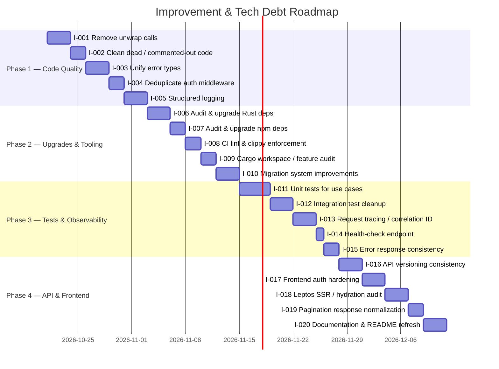
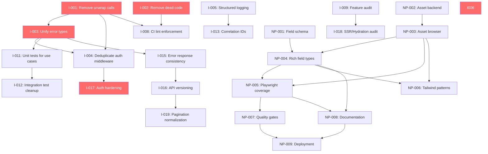

# AvoRed CMS — Improvement & Tech Debt Roadmap

> **Status**: Active — Phases 1–4 track improvement work; Phase 5 is the proposed product phase.  
> **Focus**: Improve code quality and developer experience, then deliver flexible content fields, asset management, reliable admin testing, and safer delivery.  
> **Created**: 2026-10-18

---

## Roadmap Overview

| Phase | Theme | Issues | Priority |
|-------|-------|--------|----------|
| **Phase 1** | Code Quality & Safety | #I-001 → #I-005 | 🔴 High |
| **Phase 2** | Dependency Upgrades & Tooling | #I-006 → #I-010 | 🟠 High–Medium |
| **Phase 3** | Test Coverage & Observability | #I-011 → #I-015 | 🟡 Medium |
| **Phase 4** | API Polish & Frontend Cleanup | #I-016 → #I-020 | 🟢 Medium–Low |
| **Phase 5** | Content Model, Assets & Delivery | #NP-001 → #NP-009 | 🔴 High–Medium |

---

## Phase 1 — Code Quality & Safety

---

### I-001: [Tech Debt]: Remove all `unwrap()` calls from production code

**Priority**: High  
**Phase**: Phase 1 (Code Quality)  
**Dependencies**: None

---

#### 📝 User Story
As a **developer / operator**,  
I want to **eliminate every `unwrap()` in production paths**,  
So that **the CMS never panics unexpectedly in production and returns meaningful errors instead**.

---

#### 🎯 Scope & Requirements
- [ ] Replace `unwrap()` in `main.rs` (lines 7, 15, 18) with proper error propagation (`?` operator or graceful exit with `eprintln!`)
- [ ] Replace `unwrap()` in `auth_middleware.rs` (lines 28, 73) with `?` returning an appropriate `UNAUTHORIZED` response
- [ ] Replace `unwrap()` in `rest_api_routes.rs` (line 64) with `map_err` or `filter_map`
- [ ] Replace `unwrap()` in `workflow_dispatcher.rs` (IP parse calls, lines 284-295) with compile-time validated constants or `expect()` with justification
- [ ] Replace `unwrap()` in `login_page.rs` (line 79) with user-facing error handling
- [ ] Replace `unwrap()` in `workflow.rs` domain entity serde calls (lines 66-108) with proper error propagation

---

#### ✅ Acceptance Criteria
- [ ] **Given** the full `src/` tree, **When** `grep -rn 'unwrap()' src/` is run, **Then** zero results are returned (or all remaining uses have `// SAFETY:` justification).
- [ ] **Given** an invalid CORS origin in `.env`, **When** the server starts, **Then** a descriptive error is logged instead of a panic.
- [ ] **Given** a malformed `Authorization` header, **When** a request hits the auth middleware, **Then** a `401` JSON error is returned without a panic.

---

#### 🛠️ Technical Context / Notes
* **Files affected**: `main.rs`, `auth_middleware.rs`, `rest_api_routes.rs`, `workflow_dispatcher.rs`, `login_page.rs`, `workflow.rs`
* Consider adding `#![deny(clippy::unwrap_used)]` to `lib.rs` after cleanup.

---

#### 📋 Task Checklist
- [ ] Audit all `unwrap()` call sites (19 identified)
- [ ] Replace each with `?`, `map_err`, `unwrap_or_default`, or justified `expect()`
- [ ] Add `clippy::unwrap_used` deny lint
- [ ] Verify all existing tests still pass

---

---

### I-002: [Tech Debt]: Remove dead / commented-out code

**Priority**: High  
**Phase**: Phase 1 (Code Quality)  
**Dependencies**: None

---

#### 📝 User Story
As a **developer**,  
I want to **remove all commented-out code and dead modules**,  
So that **the codebase is clean, navigable, and free of misleading artefacts**.

---

#### 🎯 Scope & Requirements
- [ ] Remove commented-out `attribute_use_case` references in `avored_state.rs` (lines 43, 85-86, 99, 123, 136)
- [ ] Remove commented-out `attribute_repository` in `persistence/mod.rs` (lines 22-23)
- [ ] Remove commented-out `attribute_use_case` in `use_cases/mod.rs` (lines 23, 25)
- [ ] Remove commented-out `avored_search_provider` in `providers/mod.rs` (line 8)
- [ ] Remove commented-out imports in `protected_routes.rs` (lines 3-4)
- [ ] Remove commented-out `entity_id` field in `attribute.rs` (line 23)
- [ ] Decide: either fully integrate the `AttributeRepository` / `AttributeUseCase` or remove the files entirely

---

#### ✅ Acceptance Criteria
- [ ] **Given** the `src/` directory, **When** `grep -rn '// pub ' src/` is run, **Then** zero hits for commented-out public declarations remain.
- [ ] **Given** `cargo build --all-features`, **When** compilation finishes, **Then** there are zero `dead_code` warnings related to attribute modules.

---

#### 🛠️ Technical Context / Notes
* The `attribute_repository.rs` file still exists in `infrastructure/persistence/` and `core/domain/repositories/` but is not wired into `AppState`. A decision is needed: delete it or re-enable it.
* `avored_search_provider` appears to be a planned module that was never implemented — remove the placeholder.

---

#### 📋 Task Checklist
- [ ] Remove all commented-out code identified above
- [ ] Run `cargo build --all-features` and fix any resulting warnings
- [ ] Run `cargo clippy` and ensure no dead-code warnings

---

---

### I-003: [Tech Debt]: Unify and improve error types

**Priority**: High  
**Phase**: Phase 1 (Code Quality)  
**Dependencies**: #I-001

---

#### 📝 User Story
As a **developer**,  
I want to **have a single, consistent error type across the codebase**,  
So that **error handling is predictable and API consumers receive uniform error responses**.

---

#### 🎯 Scope & Requirements
- [ ] Consolidate the duplicate `ErrorResponse` structs: one in `error.rs` (imported from `core::domain::entities::error_message`) and another in `auth_middleware.rs` (line 14)
- [ ] Ensure all API errors return a consistent JSON shape: `{ "status": false, "errors": [...] }` or `{ "status": false, "message": "..." }`
- [ ] Remove `format!("error 500: {:?}", err)` from the catch-all `IntoResponse` impl (line 95-96 in `error.rs`) — never expose internal error details
- [ ] Add a `Forbidden` variant to the `Error` enum for authorization failures
- [ ] Consider using `thiserror` or `anyhow` for cleaner derive-based error impls

---

#### ✅ Acceptance Criteria
- [ ] **Given** a `500` error, **When** the client reads the response body, **Then** it sees a generic error message, not a Rust debug-printed enum.
- [ ] **Given** any API error, **When** the response is parsed as JSON, **Then** it matches the unified error schema.
- [ ] **Given** the codebase, **When** searching for `struct ErrorResponse`, **Then** exactly one definition exists.

---

#### 🛠️ Technical Context / Notes
* **Backend**: Axum `IntoResponse` impl in `error.rs`
* The middleware currently defines its own `ErrorResponse` (line 12-19 of `auth_middleware.rs`) that differs from the domain `ErrorResponse`.

---

#### 📋 Task Checklist
- [ ] Merge `ErrorResponse` definitions into a single canonical type
- [ ] Update `IntoResponse` for `Error` to never leak internal details
- [ ] Add `Forbidden` variant
- [ ] Update all handler error returns to use the unified type
- [ ] Write unit tests for error serialization

---

---

### I-004: [Tech Debt]: Deduplicate auth middleware (`check_auth` / `check_customer_auth`)

**Priority**: Medium  
**Phase**: Phase 1 (Code Quality)  
**Dependencies**: #I-001, #I-003

---

#### 📝 User Story
As a **developer**,  
I want to **eliminate the duplicated JWT validation logic in the auth middleware**,  
So that **security fixes only need to be applied once and the code is DRY**.

---

#### 🎯 Scope & Requirements
- [ ] Extract common JWT decode + validation logic from `check_auth` and `check_customer_auth` into a shared private function
- [ ] Parameterize the middleware to differentiate admin vs. customer contexts via a generic or enum parameter
- [ ] Remove the fully duplicated `check_customer_auth` function (lines 67-109 of `auth_middleware.rs`)

---

#### ✅ Acceptance Criteria
- [ ] **Given** `auth_middleware.rs`, **When** reviewed, **Then** there is exactly one JWT decode implementation.
- [ ] **Given** an expired admin JWT, **When** sent to an admin-protected route, **Then** a `401` is returned with `"Token expired"` message.
- [ ] All existing integration tests pass.

---

#### 🛠️ Technical Context / Notes
* Both functions in `auth_middleware.rs` are identical except for the function name. This is a classic DRY violation.

---

#### 📋 Task Checklist
- [ ] Extract shared JWT validation into a private helper
- [ ] Refactor `check_auth` and `check_customer_auth` to call the shared helper
- [ ] Run all integration tests

---

---

### I-005: [Improvement]: Replace `println!` with structured `tracing` logging

**Priority**: Medium  
**Phase**: Phase 1 (Code Quality)  
**Dependencies**: None

---

#### 📝 User Story
As an **operator**,  
I want to **have structured, levelled logs throughout the application**,  
So that **I can filter, search, and alert on production logs effectively**.

---

#### 🎯 Scope & Requirements
- [ ] Replace `println!("listening on http://{}", 3000)` in `main.rs` with `tracing::info!`
- [ ] Replace all `log::info!` calls in `protected_routes.rs` (lines 50, 75-78, 82) with `tracing::info!` (or configure `tracing` as the `log` backend)
- [ ] Audit all `tracing::error!` calls for consistency (currently present in `error.rs` — good)
- [ ] Add `tracing::info!` for application startup events (config loaded, DB connected, migrations applied, server listening)
- [ ] Configure `tracing_subscriber` with `EnvFilter` in `main.rs` for runtime log-level control

---

#### ✅ Acceptance Criteria
- [ ] **Given** `grep -rn 'println!' src/`, **When** run, **Then** zero hits.
- [ ] **Given** `RUST_LOG=info`, **When** the server starts, **Then** structured startup logs appear.
- [ ] **Given** `RUST_LOG=debug`, **When** an API request is processed, **Then** debug-level context is logged.

---

#### 🛠️ Technical Context / Notes
* `tracing` and `tracing-subscriber` are already in `Cargo.toml` — just need to be initialized and used consistently.
* Consider adding JSON-format log output as an option for production.

---

#### 📋 Task Checklist
- [ ] Initialize `tracing_subscriber` in `main.rs`
- [ ] Replace `println!` and `log::*` with `tracing::*`
- [ ] Add startup event logs
- [ ] Verify log output at different levels

---

---

## Phase 2 — Dependency Upgrades & Tooling

---

### I-006: [Upgrade]: Audit and upgrade Rust (Cargo) dependencies

**Priority**: High  
**Phase**: Phase 2 (Dependency Upgrades)  
**Dependencies**: None

---

#### 📝 User Story
As a **developer**,  
I want to **run the latest compatible versions of all Rust dependencies**,  
So that **we benefit from security patches, bug fixes, and performance improvements**.

---

#### 🎯 Scope & Requirements
- [ ] Run `cargo outdated` and document all outdated crates
- [ ] Upgrade `rand` from `0.8` to latest (currently `0.9.x` available)
- [ ] Evaluate `surrealdb` `3.2.4` — check for newer releases and review changelogs
- [ ] Evaluate `leptos` / `leptos_router` / `leptos_meta` / `leptos_axum` `0.8.0` — check for patch releases
- [ ] Upgrade `gloo-storage` `0.4.0` and `gloo-net` `0.7` if newer versions are available
- [ ] Run `cargo audit` to check for known security vulnerabilities
- [ ] Verify `wasm-bindgen` version stays aligned with `cargo-leptos` (see comment on line 29 of `Cargo.toml`)

---

#### ✅ Acceptance Criteria
- [ ] **Given** `cargo outdated`, **When** run, **Then** all crates are on their latest compatible versions (or have documented reasons for pinning).
- [ ] **Given** `cargo audit`, **When** run, **Then** zero known vulnerabilities are reported.
- [ ] **Given** a full build (`cargo build --all-features`), **When** compiled, **Then** zero deprecation warnings.

---

#### 🛠️ Technical Context / Notes
* The `rand 0.8 to 0.9` upgrade has API changes (e.g., `thread_rng()` renamed). Test thoroughly.
* `wasm-bindgen` version must match `cargo-leptos` — check compatibility before upgrading.

---

#### 📋 Task Checklist
- [ ] Run `cargo outdated` and `cargo audit`
- [ ] Create an upgrade plan per crate
- [ ] Upgrade crates one-by-one, running tests after each
- [ ] Update `Cargo.lock`

---

---

### I-007: [Upgrade]: Audit and upgrade npm (frontend) dependencies

**Priority**: Medium  
**Phase**: Phase 2 (Dependency Upgrades)  
**Dependencies**: None

---

#### 📝 User Story
As a **developer**,  
I want to **keep frontend dependencies up to date**,  
So that **we avoid known vulnerabilities and benefit from tooling improvements**.

---

#### 🎯 Scope & Requirements
- [ ] Run `npm audit` and `npm outdated` to identify issues
- [ ] Upgrade `vite` from `^8.0.0` to latest
- [ ] Upgrade `tailwindcss` and related `@tailwindcss/*` packages from `^4.2.2`
- [ ] Upgrade `alpinejs` from `^3.15.4` and `@alpinejs/focus`
- [ ] Remove suspicious packages: `i` (`^0.3.7`) and `install` (`^0.13.0`) and `npm` (`^11.8.0`) — these are likely accidentally installed
- [ ] Move `alpinejs`, `@alpinejs/focus`, `slugify` from `devDependencies` to `dependencies` if they are runtime packages
- [ ] Update `@types/*` packages to latest

---

#### ✅ Acceptance Criteria
- [ ] **Given** `npm audit`, **When** run, **Then** zero high/critical vulnerabilities.
- [ ] **Given** `npm outdated`, **When** run, **Then** all packages are current or have documented pins.
- [ ] **Given** `npm run build`, **When** run, **Then** the frontend builds successfully with no warnings.
- [ ] The packages `i`, `install`, and `npm` are removed from `package.json`.

---

#### 🛠️ Technical Context / Notes
* `"i": "^0.3.7"`, `"install": "^0.13.0"`, and `"npm": "^11.8.0"` in devDependencies are almost certainly the result of accidentally running `npm i i install npm` — they should be removed.
* `easymde` and `feather-icons` are runtime dependencies — verify they are correct in `dependencies`.

---

#### 📋 Task Checklist
- [ ] Run `npm audit` and `npm outdated`
- [ ] Remove accidental packages (`i`, `install`, `npm`)
- [ ] Upgrade all packages
- [ ] Rebuild frontend and verify

---

---

### I-008: [Improvement]: Add CI linting with Clippy and rustfmt enforcement

**Priority**: Medium  
**Phase**: Phase 2 (Tooling)  
**Dependencies**: #I-001, #I-002

---

#### 📝 User Story
As a **developer**,  
I want to **have CI enforce code quality via `clippy` and `rustfmt`**,  
So that **code quality regressions are caught before merge**.

---

#### 🎯 Scope & Requirements
- [ ] Create or update `.github/workflows/ci.yml` with `cargo clippy -- -D warnings` and `cargo fmt -- --check`
- [ ] Add a `clippy.toml` or `#![warn(...)]` / `#![deny(...)]` attributes for project-wide lint rules
- [ ] Enforce `clippy::unwrap_used`, `clippy::expect_used` (after #I-001)
- [ ] Add `npm run build` step to CI for frontend verification
- [ ] Add `cargo test` step to CI

---

#### ✅ Acceptance Criteria
- [ ] **Given** a PR with an `unwrap()` in production code, **When** CI runs, **Then** the build fails.
- [ ] **Given** unformatted code, **When** CI runs, **Then** `rustfmt` check fails.
- [ ] **Given** a clean PR, **When** CI runs, **Then** all checks pass (clippy, fmt, test, build).

---

#### 🛠️ Technical Context / Notes
* Check if `.github/workflows/` already has CI config and extend it.

---

#### 📋 Task Checklist
- [ ] Create/update CI workflow YAML
- [ ] Configure clippy lints
- [ ] Add frontend build step
- [ ] Test CI pipeline on a branch

---

---

### I-009: [Tech Debt]: Audit Cargo features and consider workspace restructuring

**Priority**: Low  
**Phase**: Phase 2 (Tooling)  
**Dependencies**: None

---

#### 📝 User Story
As a **developer**,  
I want to **ensure Cargo features are correctly scoped and the crate structure is optimal**,  
So that **compile times are minimized and feature flags don't leak across boundaries**.

---

#### 🎯 Scope & Requirements
- [ ] Audit all `#[cfg(feature = "ssr")]` and `#[cfg(feature = "hydrate")]` gates for correctness
- [ ] Ensure no SSR-only code compiles into the WASM bundle and vice versa
- [ ] Evaluate splitting the project into a Cargo workspace (e.g., `avored-core`, `avored-web`, `avored-api`) for faster incremental builds
- [ ] Review `crate-type = ["cdylib", "rlib"]` — ensure both are needed
- [ ] Review `recursion_limit = "256"` in `main.rs` — is this still necessary?

---

#### ✅ Acceptance Criteria
- [ ] **Given** `cargo build --features hydrate`, **When** completed, **Then** no SSR dependencies are included.
- [ ] **Given** the WASM bundle, **When** inspected, **Then** no SurrealDB or Axum code is present.
- [ ] A documented decision on workspace restructuring exists (even if "not now").

---

#### 📋 Task Checklist
- [ ] Audit feature gates
- [ ] Measure build times before/after any changes
- [ ] Document workspace decision

---

---

### I-010: [Improvement]: Improve database migration system

**Priority**: Medium  
**Phase**: Phase 2 (Tooling)  
**Dependencies**: None

---

#### 📝 User Story
As a **developer**,  
I want to **have a robust, versioned migration system**,  
So that **schema changes are safe, reversible, and auditable**.

---

#### 🎯 Scope & Requirements
- [ ] Remove the `REFRESH_DATABASE` constant (line 10, `db_init.rs`) — this is dangerous if accidentally set to `true`
- [ ] Move `reset_local_database` behind a CLI flag or separate binary, not a compile-time constant
- [ ] Add `applied_at` timestamp to the `_migrations` table
- [ ] Add migration rollback / down support (or document that rollbacks are not supported)
- [ ] Use parameterised queries instead of string interpolation in `record_migration` (line 191 — SQL injection risk with migration IDs)
- [ ] Add logging for each migration applied

---

#### ✅ Acceptance Criteria
- [ ] **Given** the `REFRESH_DATABASE` constant, **When** searching the codebase, **Then** it no longer exists as a const bool.
- [ ] **Given** a fresh database, **When** migrations run, **Then** each applied migration is logged with its name and timestamp.
- [ ] **Given** `_migrations` table, **When** queried, **Then** each row has an `applied_at` datetime.

---

#### 🛠️ Technical Context / Notes
* `db_init.rs` currently uses raw string interpolation for SQL. While migration IDs are compile-time constants today, this pattern is fragile.
* Consider a migration runner library or at minimum a trait-based migration system.

---

#### 📋 Task Checklist
- [ ] Remove `REFRESH_DATABASE` const
- [ ] Add `applied_at` field to migration records
- [ ] Replace string interpolation with parameterised queries
- [ ] Add migration logging
- [ ] Create a CLI command or feature flag for database reset

---

---

## Phase 3 — Test Coverage & Observability

---

### I-011: [Improvement]: Add unit tests for application use cases

**Priority**: Medium  
**Phase**: Phase 3 (Test Coverage)  
**Dependencies**: #I-003

---

#### 📝 User Story
As a **developer**,  
I want to **have unit tests for all use case logic**,  
So that **business rules are verified independently of the database and HTTP layer**.

---

#### 🎯 Scope & Requirements
- [ ] Create mock implementations of repository traits (`AuthRepository`, `EntityRepository`, `WorkflowRepository`, etc.)
- [ ] Add unit tests for `AuthUseCase` (login validation, token generation edge cases)
- [ ] Add unit tests for `EntityUseCase` (CRUD operations, validation)
- [ ] Add unit tests for `WorkflowUseCase` (activation, execution logic)
- [ ] Add unit tests for `EmailTemplateUseCase` (CRUD, validation)
- [ ] Add unit tests for `ApiKeyUseCase` (key generation, permission checks)
- [ ] Achieve at least 70% line coverage on `core/application/use_cases/`

---

#### ✅ Acceptance Criteria
- [ ] **Given** `cargo test`, **When** run, **Then** all new unit tests pass.
- [ ] **Given** a mock repository, **When** a use case is invoked, **Then** no database connection is required.
- [ ] Use case test count of at least 20 tests across all modules.

---

#### 📋 Task Checklist
- [ ] Create mock repository trait impls
- [ ] Write unit tests per use case
- [ ] Measure coverage with `cargo tarpaulin` or `cargo llvm-cov`

---

---

### I-012: [Improvement]: Clean up and improve integration tests

**Priority**: Medium  
**Phase**: Phase 3 (Test Coverage)  
**Dependencies**: #I-011

---

#### 📝 User Story
As a **developer**,  
I want to **have well-organized, reliable integration tests**,  
So that **API behaviour is verified end-to-end and tests are easy to maintain**.

---

#### 🎯 Scope & Requirements
- [ ] Extract shared test setup/teardown into a common test fixture module
- [ ] Add integration tests for the auth endpoints (`/api/auth/login`, profile endpoints)
- [ ] Add integration tests for API key authentication (`/api/v1/*` routes)
- [ ] Ensure all integration tests use the in-memory database (`mem://`) for speed and isolation
- [ ] Add tests for error cases (invalid input, unauthorized access, not-found resources)
- [ ] Add a test for the setup flow (`/api/misc/setup`)

---

#### ✅ Acceptance Criteria
- [ ] **Given** `cargo test`, **When** all integration tests run, **Then** they complete in under 60 seconds.
- [ ] **Given** parallel test execution, **When** tests run concurrently, **Then** no test interference occurs (each test uses its own namespace).
- [ ] Integration test count of at least 25 (currently 14 files).

---

#### 📋 Task Checklist
- [ ] Refactor shared test setup into a common module
- [ ] Add missing integration tests
- [ ] Verify parallel test safety
- [ ] Run full test suite in CI

---

---

### I-013: [Improvement]: Add request tracing with correlation IDs

**Priority**: Medium  
**Phase**: Phase 3 (Observability)  
**Dependencies**: #I-005

---

#### 📝 User Story
As an **operator**,  
I want to **have a unique correlation ID for every API request**,  
So that **I can trace request flows through logs and debug issues efficiently**.

---

#### 🎯 Scope & Requirements
- [ ] Add an Axum middleware layer that generates a UUID correlation ID for each request
- [ ] Attach the correlation ID to the `tracing` span so all logs within a request include it
- [ ] Return the correlation ID in the `X-Request-Id` response header
- [ ] Include the correlation ID in error responses

---

#### ✅ Acceptance Criteria
- [ ] **Given** any API request, **When** the response is received, **Then** an `X-Request-Id` header is present.
- [ ] **Given** a failed request, **When** the error response is inspected, **Then** the correlation ID is included.
- [ ] **Given** server logs, **When** filtered by a correlation ID, **Then** all logs for that request are found.

---

#### 📋 Task Checklist
- [ ] Create correlation ID middleware
- [ ] Integrate with `tracing` spans
- [ ] Add `X-Request-Id` to responses
- [ ] Add correlation ID to error responses

---

---

### I-014: [Improvement]: Add health-check endpoint

**Priority**: Low  
**Phase**: Phase 3 (Observability)  
**Dependencies**: None

---

#### 📝 User Story
As an **operator / DevOps engineer**,  
I want to **have a `/health` endpoint**,  
So that **load balancers and monitoring systems can verify the CMS is running and connected to the database**.

---

#### 🎯 Scope & Requirements
- [ ] Add `GET /health` endpoint (unauthenticated)
- [ ] Return `200 OK` with `{ "status": "healthy", "database": "connected", "version": "0.1.0" }`
- [ ] Check database connectivity as part of the health check
- [ ] Return `503 Service Unavailable` if the database is unreachable

---

#### ✅ Acceptance Criteria
- [ ] **Given** a running server with a healthy database, **When** `GET /health` is called, **Then** `200` with `"healthy"` is returned.
- [ ] **Given** a running server with a disconnected database, **When** `GET /health` is called, **Then** `503` is returned.

---

#### 📋 Task Checklist
- [ ] Create health-check handler
- [ ] Add route to `rest_api_routes.rs`
- [ ] Add integration test

---

---

### I-015: [Tech Debt]: Normalize API error responses across all handlers

**Priority**: Medium  
**Phase**: Phase 3 (Observability)  
**Dependencies**: #I-003

---

#### 📝 User Story
As an **API consumer**,  
I want to **receive consistent error responses from every endpoint**,  
So that **my client code can handle errors uniformly**.

---

#### 🎯 Scope & Requirements
- [ ] Audit all handler functions for inconsistent error return formats
- [ ] Ensure validation errors always return `400` with `{ "status": false, "errors": [{ "key": "...", "message": "..." }] }`
- [ ] Ensure `404` errors always return `{ "status": false, "message": "Resource not found" }`
- [ ] Ensure `500` errors never expose internal details
- [ ] Document the error response contract in an API guide

---

#### ✅ Acceptance Criteria
- [ ] **Given** any `4xx` or `5xx` response, **When** parsed as JSON, **Then** it conforms to the documented error schema.
- [ ] **Given** the API documentation, **When** reviewed, **Then** the error contract is clearly documented.

---

#### 📋 Task Checklist
- [ ] Audit all handler error returns
- [ ] Normalize to the unified error schema
- [ ] Document error response contract
- [ ] Add integration tests for error cases

---

---

## Phase 4 — API Polish & Frontend Cleanup

---

### I-016: [Tech Debt]: Standardize API route versioning

**Priority**: Medium  
**Phase**: Phase 4 (API Polish)  
**Dependencies**: #I-015

---

#### 📝 User Story
As an **API consumer**,  
I want to **have consistent API versioning**,  
So that **I know which endpoints are stable and can plan for version migration**.

---

#### 🎯 Scope & Requirements
- [ ] Currently, some routes are `/api/collection`, `/api/entities`, `/api/workflows` (unversioned) while others are `/api/v1/entities`, `/api/v1/admin/me` (versioned)
- [ ] Decide on a versioning strategy: either all routes under `/api/v1/` or keep internal admin routes unversioned
- [ ] Document which routes are "internal admin" vs. "public API"
- [ ] Add deprecation headers for any routes that will be moved
- [ ] Ensure the API key-authenticated routes (`/api/v1/*`) are clearly separated from JWT-authenticated routes

---

#### ✅ Acceptance Criteria
- [ ] **Given** the API route table, **When** reviewed, **Then** every route has a clear versioning rationale documented.
- [ ] **Given** the public API, **When** an external consumer reads the docs, **Then** all public routes are under `/api/v1/`.

---

#### 📋 Task Checklist
- [ ] Audit all routes and categorize (admin vs. public)
- [ ] Migrate routes to consistent versioning
- [ ] Add deprecation headers for old routes
- [ ] Update API documentation

---

---

### I-017: [Improvement]: Harden frontend authentication flow

**Priority**: High  
**Phase**: Phase 4 (Frontend)  
**Dependencies**: #I-004

---

#### 📝 User Story
As a **CMS admin user**,  
I want to **have a secure and reliable authentication experience**,  
So that **my session is protected, and I'm redirected appropriately on expiry**.

---

#### 🎯 Scope & Requirements
- [ ] Replace hardcoded "Demo User" fallback in `protected_routes.rs` (lines 33-35) with actual user data from the JWT token or an API call
- [ ] Implement JWT token refresh before expiry
- [ ] Add proper logout flow that clears `localStorage` and invalidates the session
- [ ] Handle token expiry gracefully on the frontend (redirect to login with a message)
- [ ] Consider using `HttpOnly` cookies instead of `localStorage` for token storage (XSS mitigation)

---

#### ✅ Acceptance Criteria
- [ ] **Given** a logged-in user, **When** their token expires, **Then** they are redirected to login with a "Session expired" message.
- [ ] **Given** a logged-in user, **When** they visit `/admin`, **Then** their actual name and email are displayed (not "Demo User").
- [ ] **Given** a logged-in user, **When** they click logout, **Then** the token is cleared from storage and they're redirected to login.

---

#### 🛠️ Technical Context / Notes
* `protected_routes.rs` currently returns hardcoded user data (`"demo-user-id"`, `"Demo User"`, `"demo@avored.local"`) when a token is found in localStorage — this is a placeholder that needs to be replaced with real user data.
* Consider decoding the JWT claims on the client side to populate the `LoggedInUser` struct.

---

#### 📋 Task Checklist
- [ ] Replace hardcoded demo user with real JWT claims
- [ ] Implement token refresh mechanism
- [ ] Add logout flow
- [ ] Handle token expiry on frontend
- [ ] Evaluate HttpOnly cookie approach

---

---

### I-018: [Tech Debt]: Audit Leptos SSR / Hydration boundaries

**Priority**: Medium  
**Phase**: Phase 4 (Frontend)  
**Dependencies**: #I-009

---

#### 📝 User Story
As a **developer**,  
I want to **ensure the SSR/hydration boundary is clean and correct**,  
So that **there are no hydration mismatches, WASM bundle bloat, or SSR-only code leaking to the client**.

---

#### 🎯 Scope & Requirements
- [ ] Audit all `#[cfg(target_arch = "wasm32")]` and `#[cfg(not(target_arch = "wasm32"))]` gates
- [ ] Verify no SurrealDB, Axum, or file-system code is accessible from Leptos components without feature gates
- [ ] Check for hydration mismatch warnings in the browser console
- [ ] Verify `Shell` component renders correctly on both SSR and hydration
- [ ] Ensure `provide_auth_context` works correctly on both server and client

---

#### ✅ Acceptance Criteria
- [ ] **Given** the WASM bundle, **When** its size is measured, **Then** it does not contain SSR-only dependencies.
- [ ] **Given** any page, **When** loaded in the browser, **Then** zero hydration mismatch warnings appear in the console.

---

#### 📋 Task Checklist
- [ ] Audit all platform-specific `cfg` gates
- [ ] Check WASM bundle for SSR code leakage
- [ ] Fix any hydration mismatches
- [ ] Document SSR/hydration boundaries

---

---

### I-019: [Improvement]: Normalize pagination responses across all list endpoints

**Priority**: Low  
**Phase**: Phase 4 (API Polish)  
**Dependencies**: #I-016

---

#### 📝 User Story
As an **API consumer**,  
I want to **receive consistent pagination metadata from all list endpoints**,  
So that **I can build generic pagination UI components**.

---

#### 🎯 Scope & Requirements
- [ ] Ensure all paginated endpoints (`/api/collection`, `/api/entities`, `/api/email-templates`, `/api/workflows`, `/api/api-keys`, `/api/v1/entities`) return the same pagination envelope
- [ ] Standard pagination response: `{ "data": [...], "pagination": { "total": N, "per_page": N, "current_page": N, "last_page": N } }`
- [ ] Support `?page=N&per_page=N` query parameters consistently
- [ ] Default `per_page` to a sensible value (e.g., 25)

---

#### ✅ Acceptance Criteria
- [ ] **Given** any list endpoint, **When** called with pagination params, **Then** the response contains `data` and `pagination` keys.
- [ ] **Given** `?page=2&per_page=10`, **When** sent to any list endpoint, **Then** the correct page of results is returned.

---

#### 📋 Task Checklist
- [ ] Create a generic `PaginatedResponse<T>` wrapper
- [ ] Update all list handlers to use the wrapper
- [ ] Standardize query parameters
- [ ] Add integration tests for pagination

---

---

### I-020: [Improvement]: Refresh README and add developer documentation

**Priority**: Low  
**Phase**: Phase 4 (Documentation)  
**Dependencies**: None

---

#### 📝 User Story
As a **new contributor**,  
I want to **have up-to-date README and developer documentation**,  
So that **I can set up the project, understand the architecture, and start contributing quickly**.

---

#### 🎯 Scope & Requirements
- [ ] Update `README.md` with current setup instructions (prerequisites, env vars, database setup)
- [ ] Document the architecture (clean architecture layers: domain, application, infrastructure, interfaces)
- [ ] Add an API reference page listing all endpoints with their auth requirements
- [ ] Document the development workflow (`npm run dev`, `cargo leptos watch`, etc.)
- [ ] Add a `CONTRIBUTING.md` with coding standards, PR process, and testing guidelines
- [ ] Document environment variables from `.env` with descriptions and defaults

---

#### ✅ Acceptance Criteria
- [ ] **Given** a new developer, **When** they follow the README, **Then** they can run the CMS locally within 15 minutes.
- [ ] **Given** the docs, **When** a developer looks for any API endpoint, **Then** they find its documentation.
- [ ] **Given** `CONTRIBUTING.md`, **When** read, **Then** coding standards and PR process are clear.

---

#### 📋 Task Checklist
- [ ] Update `README.md`
- [ ] Create architecture documentation
- [ ] Create API reference
- [ ] Create `CONTRIBUTING.md`
- [ ] Document all environment variables

---

---

## Phase 5 — Next Product Phase

> **Status**: Proposed — GitHub issues created as [#398–#406](https://github.com/avored/avored-rust-cms/issues/398).
> **Tailwind CSS** is already part of the project; this phase standardizes its use rather than adding a new styling dependency.

### NP-001 — Add reusable field schema foundation

**Title:** `[NP-001] [Feature]: Add reusable field schema foundation for entity forms`

**Priority**: High  
**Phase**: Next Phase — Content Model Foundation  
**Dependencies**: None
**GitHub Issue**: [#398](https://github.com/avored/avored-rust-cms/issues/398)

---

### 📝 User Story
As a CMS administrator,  
I want reusable, validated field definitions for entities,  
So that content forms can support multiple field types consistently.

### 🎯 Scope & Requirements
- [ ] Define a field-definition model with stable ID, name, label, type, required flag, and validation/configuration metadata.
- [ ] Persist field definitions with the entity or content-model configuration using the repository's existing persistence patterns.
- [ ] Validate field names, duplicate definitions, and type-specific configuration on create and update.
- [ ] Expose the field definitions through the existing admin API patterns.
- [ ] Preserve compatibility with existing entities and records that have no new field definitions.

### ✅ Acceptance Criteria
- [ ] **Given** a valid field definition, **When** an administrator saves it, **Then** it is persisted and returned by the admin API.
- [ ] **Given** a malformed or duplicate definition, **When** it is submitted, **Then** the API returns a structured validation error and does not persist it.
- [ ] **Given** existing entity data, **When** the schema support is deployed, **Then** existing records remain readable and editable.

### 🛠️ Technical Context / Notes
* **Backend / API**: Follow existing Axum request, response, and validation conventions.
* **Frontend**: Keep the schema representation consumable by the Leptos admin form builder.
* **Database / Data model**: Reuse the current entity configuration persistence model where suitable; avoid introducing a parallel schema store without need.

### 📋 Task Checklist
- [ ] Define and validate the field-definition model
- [ ] Add persistence and API support
- [ ] Preserve compatibility with existing entities
- [ ] Add focused unit and API tests

---

### NP-002 — Add asset and folder management backend

**Title:** `[NP-002] [Feature]: Add asset storage backend with folders and upload support`

**Priority**: High  
**Phase**: Next Phase — Asset Foundation  
**Dependencies**: None
**GitHub Issue**: [#399](https://github.com/avored/avored-rust-cms/issues/399)

---

### 📝 User Story
As a content editor,  
I want to upload files and organize them into folders,  
So that assets can be managed and reused across content.

### 🎯 Scope & Requirements
- [ ] Define asset metadata including stable ID, original filename, storage key, MIME type, size, folder, and creation time.
- [ ] Support folder listing and creation, with a documented policy for nesting.
- [ ] Add an authenticated upload endpoint with configurable storage location and size/type validation.
- [ ] Store files using generated storage keys rather than trusting client-provided paths or filenames.
- [ ] Add API operations to list, retrieve, and delete assets and folders, with appropriate authorization.
- [ ] Ensure failed uploads do not leave orphaned metadata or partially written files.

### ✅ Acceptance Criteria
- [ ] **Given** an authenticated user uploads an allowed file, **When** the upload succeeds, **Then** the file and its metadata are available through the asset API.
- [ ] **Given** an unsupported or oversized upload, **When** it is submitted, **Then** the API returns a clear validation error and no asset is recorded.
- [ ] **Given** a folder, **When** an asset is uploaded to it, **Then** the asset is listed under that folder.
- [ ] **Given** a client-supplied filename containing path separators, **When** it is uploaded, **Then** storage remains confined to the configured asset location.

### 🛠️ Technical Context / Notes
* **Backend / API**: Use Axum multipart handling and the project's existing auth/error conventions.
* **Storage**: Keep storage location configurable and isolate storage implementation so local filesystem storage can be replaced later.
* **Database / Data model**: Persist metadata and folder relations; do not store raw file bytes in the metadata record.
* **Security**: Validate authorization, size, MIME/type policy, and generated storage paths.

### 📋 Task Checklist
- [ ] Define asset/folder models and persistence
- [ ] Implement authenticated upload and asset-management endpoints
- [ ] Add validation and cleanup behavior for failed uploads/deletes
- [ ] Add unit and integration tests for valid and rejected requests

---

### NP-003 — Build the admin asset browser and upload flow

**Title:** `[NP-003] [Feature]: Build admin asset browser and upload flow`

**Priority**: High  
**Phase**: Next Phase — Admin Asset Management  
**Dependencies**: NP-002
**GitHub Issue**: [#400](https://github.com/avored/avored-rust-cms/issues/400)

---

### 📝 User Story
As a CMS administrator,  
I want to browse folders, upload files, and select existing assets,  
So that I can manage media from the admin interface.

### 🎯 Scope & Requirements
- [ ] Add an admin asset page using the existing Leptos routing and layout conventions.
- [ ] Display folders and assets with filename, file type, size, and upload date.
- [ ] Support folder navigation and the folder operations provided by the API.
- [ ] Add an upload interaction with progress and actionable validation/error feedback.
- [ ] Support selecting an asset and returning its stable ID to a caller such as a content form.
- [ ] Provide accessible loading, empty, and error states.

### ✅ Acceptance Criteria
- [ ] **Given** an administrator opens the asset page, **When** assets are available, **Then** folders and files are displayed with their metadata.
- [ ] **Given** a valid file, **When** the administrator uploads it, **Then** it appears in the current folder without a full-page reload.
- [ ] **Given** an API upload failure, **When** it occurs, **Then** the UI displays an actionable error and does not show the upload as successful.
- [ ] **Given** a caller requests asset selection, **When** the administrator chooses an asset, **Then** the caller receives its stable asset ID.

### 🛠️ Technical Context / Notes
* **Frontend**: Follow existing Leptos page, routing, and API client patterns.
* **Styling**: Use the existing Tailwind setup and accessible interaction patterns.
* **Backend / API**: Consume NP-002 endpoints; avoid duplicating validation rules in the UI.

### 📋 Task Checklist
- [ ] Add the admin route and asset browser page
- [ ] Implement folder navigation and upload interaction
- [ ] Implement asset selection integration
- [ ] Add UI tests for loading, empty, success, and error states

---

### NP-004 — Add textarea, dropdown, image, and number field types

**Title:** `[NP-004] [Feature]: Add textarea, dropdown, image, and number field types`

**Priority**: High  
**Phase**: Next Phase — Rich Content Forms  
**Dependencies**: NP-001, NP-003
**GitHub Issue**: [#401](https://github.com/avored/avored-rust-cms/issues/401)

---

### 📝 User Story
As a CMS administrator,  
I want textarea, dropdown, image, and number fields in content forms,  
So that I can model common content without custom workarounds.

### 🎯 Scope & Requirements
- [ ] Add textarea configuration and rendering, including required validation.
- [ ] Add dropdown configuration with validated options and a defined stored value.
- [ ] Add an image field that references an asset by stable asset ID and uses the asset browser for selection.
- [ ] Add a number field with integer/decimal configuration and relevant min/max validation.
- [ ] Validate submitted values against the configured field definitions on the backend.
- [ ] Preserve existing field rendering and saved content behavior.

### ✅ Acceptance Criteria
- [ ] **Given** a textarea field, **When** content is saved, **Then** its complete text value is persisted and displayed on edit.
- [ ] **Given** a dropdown field, **When** an allowed option is selected and saved, **Then** the selected value is persisted; unconfigured values are rejected.
- [ ] **Given** an image field, **When** an asset is selected, **Then** the stable asset reference is persisted and can be resolved when the form is reopened.
- [ ] **Given** a number field with configured constraints, **When** a value violates them, **Then** save is rejected with a field-specific validation error.
- [ ] **Given** an entity using existing fields, **When** the new renderers are introduced, **Then** existing fields continue to work.

### 🛠️ Technical Context / Notes
* **Backend / API**: Extend the field schema and validation introduced in NP-001.
* **Frontend**: Use Leptos field components and the asset selector from NP-003.
* **Database / Data model**: Store image values as asset references, not copied URLs or file contents.

### 📋 Task Checklist
- [ ] Add field configuration and backend validation for all four types
- [ ] Add form renderers and edit-state hydration
- [ ] Integrate image selection with the asset browser
- [ ] Add focused tests for valid, invalid, and persisted values

---

### NP-005 — Add Playwright coverage for admin content and asset flows

**Title:** `[NP-005] [Improvement]: Add Playwright coverage for admin content and asset flows`

**Priority**: High  
**Phase**: Next Phase — Regression Testing  
**Dependencies**: NP-003, NP-004
**GitHub Issue**: [#402](https://github.com/avored/avored-rust-cms/issues/402)

---

### 📝 User Story
As a developer,  
I want browser-level tests for critical admin workflows,  
So that regressions in content forms and asset management are caught before release.

### 🎯 Scope & Requirements
- [ ] Configure Playwright for the existing frontend/build and local test environment.
- [ ] Add a deterministic test setup for authentication and test data without using production credentials or data.
- [ ] Cover an admin login/session smoke flow using the project's supported test approach.
- [ ] Cover content create/edit and validation for textarea, dropdown, image, and number fields.
- [ ] Cover asset upload and selection using a small test fixture.
- [ ] Ensure tests can run locally and in CI with clear failure diagnostics.

### ✅ Acceptance Criteria
- [ ] **Given** the test environment is available, **When** the Playwright suite runs, **Then** the critical admin flows execute without manual interaction.
- [ ] **Given** invalid field data, **When** a browser test submits it, **Then** the corresponding validation feedback is visible and the invalid value is not saved.
- [ ] **Given** an upload fixture, **When** the browser test uploads and selects it, **Then** the asset appears and its reference is saved in the content form.
- [ ] **Given** an application or test setup failure, **When** the suite runs, **Then** the failure is reported rather than silently skipped.

### 🛠️ Technical Context / Notes
* Playwright tests are browser end-to-end tests, not Rust unit tests; keep fast unit/API tests in their existing test layers.
* **CI**: Use deterministic setup and bounded timeouts; do not require production secrets.
* **Test data**: Isolate test data and clean it up safely after each run.

### 📋 Task Checklist
- [ ] Add Playwright configuration and test scripts
- [ ] Add isolated authentication and test-data setup
- [ ] Add content form and asset flow tests
- [ ] Document local execution and integrate with CI

---

### NP-006 — Standardize Tailwind patterns for admin forms

**Title:** `[NP-006] [Improvement]: Standardize Tailwind patterns for admin forms`

**Priority**: Medium  
**Phase**: Next Phase — Admin UI Consistency  
**Dependencies**: NP-003, NP-004
**GitHub Issue**: [#403](https://github.com/avored/avored-rust-cms/issues/403)

---

### 📝 User Story
As a frontend developer,  
I want consistent Tailwind patterns for admin forms and asset screens,  
So that the interface remains accessible and maintainable as it grows.

### 🎯 Scope & Requirements
- [ ] Review existing form and admin-page styles and identify patterns directly relevant to the new workflows.
- [ ] Establish reusable conventions or components for labels, inputs, validation messages, buttons, and empty/loading states.
- [ ] Apply the conventions to the asset browser and new field types.
- [ ] Preserve responsive layouts, keyboard interaction, and existing theme behavior.
- [ ] Document how future admin forms should use the existing Tailwind setup.

### ✅ Acceptance Criteria
- [ ] **Given** the new asset and field screens, **When** rendered, **Then** shared controls use consistent spacing, focus, disabled, and validation states.
- [ ] **Given** keyboard-only interaction, **When** a user navigates the controls, **Then** focus is visible and controls remain operable.
- [ ] **Given** the project frontend build, **When** the updated pages are built, **Then** no additional Tailwind installation or parallel styling system is introduced.

### 🛠️ Technical Context / Notes
* **Frontend**: Leptos components with the project's existing Tailwind CSS v4 pipeline.
* Keep changes scoped to patterns needed by this phase; avoid a broad visual redesign.

### 📋 Task Checklist
- [ ] Identify and document shared admin form patterns
- [ ] Apply shared patterns to asset and field screens
- [ ] Check responsive and keyboard-accessible states
- [ ] Add or update relevant UI checks

---

### NP-007 — Strengthen codebase quality checks for the new workflows

**Title:** `[NP-007] [Improvement]: Strengthen codebase quality checks for admin workflows`

**Priority**: Medium  
**Phase**: Next Phase — Quality Gates  
**Dependencies**: NP-005
**GitHub Issue**: [#404](https://github.com/avored/avored-rust-cms/issues/404)

---

### 📝 User Story
As a maintainer,  
I want automated quality checks for backend and frontend changes,  
So that regressions are detected consistently before merge.

### 🎯 Scope & Requirements
- [ ] Review current CI workflows and reuse existing jobs where possible.
- [ ] Ensure applicable Rust formatting, lint, and test checks run for pull requests.
- [ ] Ensure frontend build and Playwright checks run with appropriate dependency caching and timeouts.
- [ ] Fix warnings or test instability introduced by this phase; do not bundle unrelated broad refactors.
- [ ] Report failed checks clearly and preserve test artifacts needed to diagnose browser failures.

### ✅ Acceptance Criteria
- [ ] **Given** a pull request with a formatting or compile failure, **When** CI runs, **Then** the corresponding check fails with actionable output.
- [ ] **Given** a pull request changing admin workflows, **When** CI runs, **Then** the relevant Playwright checks are executed.
- [ ] **Given** a test failure, **When** CI completes, **Then** the failed test output and useful browser artifacts are available.

### 🛠️ Technical Context / Notes
* **CI**: Extend current GitHub Actions rather than creating duplicate workflows.
* Keep secrets out of test jobs unless strictly necessary; prefer local deterministic fixtures.

### 📋 Task Checklist
- [ ] Audit current CI coverage and add only missing checks
- [ ] Integrate Playwright with stable setup and diagnostics
- [ ] Resolve phase-related warnings and flaky tests
- [ ] Verify checks on a representative pull request branch

---

### NP-008 — Document content fields, assets, and contributor workflows

**Title:** `[NP-008] [Documentation]: Document content fields, assets, and contributor workflows`

**Priority**: Medium  
**Phase**: Next Phase — Documentation  
**Dependencies**: NP-004, NP-005
**GitHub Issue**: [#405](https://github.com/avored/avored-rust-cms/issues/405)

---

### 📝 User Story
As a new contributor or CMS administrator,  
I want accurate documentation for content fields, asset handling, and development checks,  
So that I can use and extend the new workflows correctly.

### 🎯 Scope & Requirements
- [ ] Update setup documentation with current prerequisites, configuration, and local run instructions.
- [ ] Document supported field types, field configuration, validation, and image asset references.
- [ ] Document upload storage configuration, folder behavior, validation, and operational considerations.
- [ ] Document Playwright setup and local/CI test commands.
- [ ] Document the existing Tailwind workflow and conventions for admin screens.

### ✅ Acceptance Criteria
- [ ] **Given** a developer follows the setup documentation, **When** prerequisites are available, **Then** they can run the app and relevant checks locally.
- [ ] **Given** an administrator or developer reads the field documentation, **When** configuring a field, **Then** supported options and validation behavior are clear.
- [ ] **Given** the asset documentation, **When** an operator configures storage, **Then** they can identify required settings and storage safety considerations.

### 🛠️ Technical Context / Notes
* Update existing documentation where appropriate instead of duplicating instructions.
* Documentation must describe implemented behavior and configuration, not planned behavior.

### 📋 Task Checklist
- [ ] Update setup and contributor documentation
- [ ] Document field types and validation
- [ ] Document asset configuration and handling
- [ ] Document Tailwind and Playwright workflows

---

### NP-009 — Add GitHub Actions deployment workflow

**Title:** `[NP-009] [Automation]: Add GitHub Actions workflow for server deployment`

**Priority**: Medium  
**Phase**: Next Phase — Release Automation  
**Dependencies**: NP-007, NP-008
**GitHub Issue**: [#406](https://github.com/avored/avored-rust-cms/issues/406)

---

### 📝 User Story
As a project maintainer,  
I want a controlled deployment workflow for the server,  
So that validated releases can be deployed consistently and verified afterward.

### 🎯 Scope & Requirements
- [ ] Document and implement the deployment target and release trigger (for example, a protected branch or version tag).
- [ ] Run required build and test checks before deployment.
- [ ] Deploy through a controlled runner or SSH using GitHub Environments and repository-managed secrets.
- [ ] Keep credentials and environment configuration out of source control and logs.
- [ ] Add deployment verification, including an application health check where available.
- [ ] Define failure behavior and a safe rollback or recovery procedure.
- [ ] Make production deployment approval configurable through environment protection rules.

### ✅ Acceptance Criteria
- [ ] **Given** a deployment trigger, **When** required checks pass and approvals are satisfied, **Then** the workflow deploys the intended revision to the configured target.
- [ ] **Given** a failed build, test, or deployment step, **When** the workflow runs, **Then** deployment does not proceed or is clearly marked failed.
- [ ] **Given** a completed deployment, **When** verification runs, **Then** the workflow only reports success after the deployed service responds as expected.
- [ ] **Given** deployment credentials, **When** the workflow executes, **Then** they are sourced from protected secrets and are not printed in logs.

### 🛠️ Technical Context / Notes
* **CI/CD**: Use GitHub Actions and environment protection; deployment should not run on untrusted pull-request code.
* **Operations**: The target OS, service manager, artifact strategy, and rollback mechanism must be documented before enabling production deployment.
* Do not commit credentials, private keys, or server environment files.

### 📋 Task Checklist
- [ ] Document deployment target and trigger assumptions
- [ ] Add protected deployment workflow and required pre-deploy checks
- [ ] Add secure secret handling and post-deploy verification
- [ ] Document recovery/rollback and validate against a non-production target

---

---

## Dependency Graph

---

## Summary — Issue Index

| ID | Title | Priority | Phase | Dependencies |
|----|-------|----------|-------|--------------|
| I-001 | Remove all `unwrap()` calls from production code | 🔴 High | 1 | None |
| I-002 | Remove dead / commented-out code | 🔴 High | 1 | None |
| I-003 | Unify and improve error types | 🔴 High | 1 | I-001 |
| I-004 | Deduplicate auth middleware | 🟡 Medium | 1 | I-001, I-003 |
| I-005 | Replace `println!` with structured `tracing` logging | 🟡 Medium | 1 | None |
| I-006 | Audit and upgrade Rust (Cargo) dependencies | 🔴 High | 2 | None |
| I-007 | Audit and upgrade npm (frontend) dependencies | 🟡 Medium | 2 | None |
| I-008 | Add CI linting with Clippy and rustfmt enforcement | 🟡 Medium | 2 | I-001, I-002 |
| I-009 | Audit Cargo features and consider workspace restructuring | 🟢 Low | 2 | None |
| I-010 | Improve database migration system | 🟡 Medium | 2 | None |
| I-011 | Add unit tests for application use cases | 🟡 Medium | 3 | I-003 |
| I-012 | Clean up and improve integration tests | 🟡 Medium | 3 | I-011 |
| I-013 | Add request tracing with correlation IDs | 🟡 Medium | 3 | I-005 |
| I-014 | Add health-check endpoint | 🟢 Low | 3 | None |
| I-015 | Normalize API error responses across all handlers | 🟡 Medium | 3 | I-003 |
| I-016 | Standardize API route versioning | 🟡 Medium | 4 | I-015 |
| I-017 | Harden frontend authentication flow | 🔴 High | 4 | I-004 |
| I-018 | Audit Leptos SSR / Hydration boundaries | 🟡 Medium | 4 | I-009 |
| I-019 | Normalize pagination responses | 🟢 Low | 4 | I-016 |
| I-020 | Refresh README and add developer documentation | 🟢 Low | 4 | None |
| NP-001 | Add reusable field schema foundation | 🔴 High | 5 | None — [#398](https://github.com/avored/avored-rust-cms/issues/398) |
| NP-002 | Add asset and folder management backend | 🔴 High | 5 | None — [#399](https://github.com/avored/avored-rust-cms/issues/399) |
| NP-003 | Build admin asset browser and upload flow | 🔴 High | 5 | NP-002 — [#400](https://github.com/avored/avored-rust-cms/issues/400) |
| NP-004 | Add textarea, dropdown, image, and number field types | 🔴 High | 5 | NP-001, NP-003 — [#401](https://github.com/avored/avored-rust-cms/issues/401) |
| NP-005 | Add Playwright coverage for admin content and asset flows | 🔴 High | 5 | NP-003, NP-004 — [#402](https://github.com/avored/avored-rust-cms/issues/402) |
| NP-006 | Standardize Tailwind patterns for admin forms | 🟡 Medium | 5 | NP-003, NP-004 — [#403](https://github.com/avored/avored-rust-cms/issues/403) |
| NP-007 | Strengthen codebase quality checks for admin workflows | 🟡 Medium | 5 | NP-005 — [#404](https://github.com/avored/avored-rust-cms/issues/404) |
| NP-008 | Document content fields, assets, and contributor workflows | 🟡 Medium | 5 | NP-004, NP-005 — [#405](https://github.com/avored/avored-rust-cms/issues/405) |
| NP-009 | Add GitHub Actions deployment workflow | 🟡 Medium | 5 | NP-007, NP-008 — [#406](https://github.com/avored/avored-rust-cms/issues/406) |

---

> **Next Step**: Begin implementation with NP-001 and NP-002; the Phase 5 GitHub issues and dependency order are recorded above.
