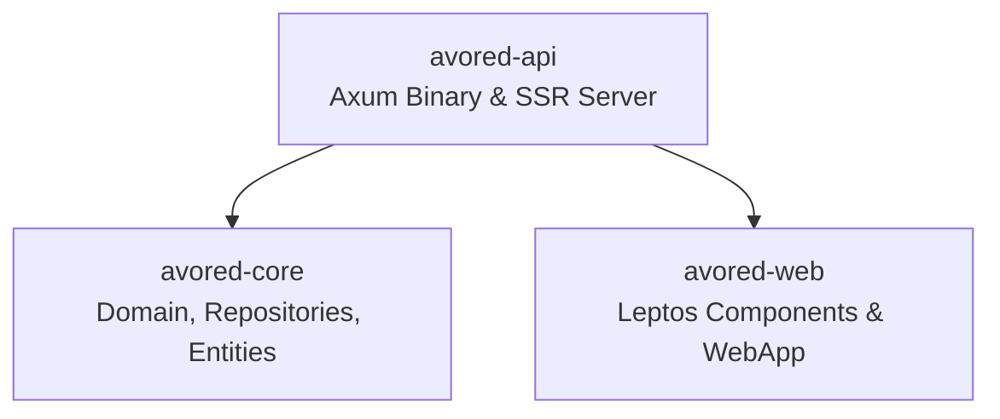

# Leptos SSR and Hydration Boundary Architecture

This document outlines the architectural boundaries, feature gating rules, and hydration safety practices for AvoRed Rust CMS.

---

## 1. Crate Architecture & Decoupling

The workspace divides responsibilities across three primary crates:



* **`avored-core`**: Core business domain, entities, DTOs, repository traits, and database persistence models.
* **`avored-web`**: Pure frontend Leptos views, components, routing, and styling.
  * **Strict Isolation Rule:** `avored-web` MUST NOT depend on `avored-core`, `avored-api`, `surrealdb`, `axum`, `tokio`, or server-side file-system libraries.
  * This guarantees that client WASM binaries remain lean and completely free of server-side data access logic or database engine bloat.
* **`avored-api`**: The Axum web server that bridges HTTP/REST handlers, database sessions, and Leptos SSR rendering via `.leptos_routes_with_context(...)`.

---

## 2. Cargo Feature Flags & Target Matrix

The frontend crate `avored-web` supports dual-mode compilation:

| Feature / Target | Purpose | Key Dependencies Enabled |
|---|---|---|
| `ssr` (non-wasm32) | Server-side HTML generation inside `avored-api` | `leptos/ssr`, `leptos_meta/ssr`, `leptos_router/ssr` |
| `hydrate` (`wasm32-unknown-unknown`) | Client-side reactive hydration in the browser | `leptos/hydrate`, `wasm-bindgen`, `console_error_panic_hook`, `console_log` |

### Cargo Leptos Workspace Configuration
In the workspace `Cargo.toml`:
```toml
[[workspace.metadata.leptos]]
name = "avored-rust-cms"
bin-package = "avored-api"
lib-package = "avored-web"
bin-target = "avored-api"
site-root = "target/site"
site-pkg-dir = "pkg"
assets-dir = "public"
bin-features = ["ssr"]
bin-default-features = false
lib-features = ["hydrate"]
lib-default-features = false
lib-profile-release = "wasm-release"
```

---

## 3. Platform `cfg` Gating Guidelines

When authoring Leptos components in `avored-web`:

### A. Client-Only APIs (`LocalStorage`, `gloo-storage`, `gloo-net`, `web-sys`)
Browser storage and networking APIs are only available when targeting `wasm32`. They must always be guarded:

```rust
// Imports
#[cfg(target_arch = "wasm32")]
use gloo_storage::{LocalStorage, Storage};

// Inside component actions or handlers
let on_submit = move |ev: leptos::ev::SubmitEvent| {
    ev.prevent_default();

    #[cfg(target_arch = "wasm32")]
    {
        // Execute client-side fetch or browser storage writes
        let _ = LocalStorage::set("auth_token", token.clone());
    }

    #[cfg(not(target_arch = "wasm32"))]
    {
        // Silence unused captures during SSR compilation without runtime cost
        let _ = &email;
    }
};
```

### B. Deterministic Initial State (`provide_auth_context`)
To avoid hydration mismatch flashes, contexts provided during SSR must produce a stable fallback that client hydration can seamlessly reconcile:

```rust
pub fn provide_auth_context() {
    #[cfg(target_arch = "wasm32")]
    let (initial_logged_in, initial_token, initial_user) = {
        // Read from LocalStorage if present in the browser
        ...
    };

    #[cfg(not(target_arch = "wasm32"))]
    let (initial_logged_in, initial_token, initial_user) = (false, String::new(), None);

    provide_context(AuthContext {
        is_logged_in: RwSignal::new(initial_logged_in),
        auth_token: RwSignal::new(initial_token),
        logged_in_user: RwSignal::new(initial_user),
        auth_ready: RwSignal::new(true),
    });
}
```

---

## 4. Hydration Mismatch Safeguards

1. **Document Framing vs Router Hierarchy**:
   * `Shell` (`crates/avored-web/src/interfaces/web/shell.rs`) generates the full HTML outer document (`<!DOCTYPE html>`, `<html>`, `<head>`, `<body>`) during SSR.
   * `WebApp` (`crates/avored-web/src/interfaces/web/web_routes.rs`) is mounted directly into `<body>` via `leptos::mount::hydrate_body(WebApp)`.
2. **Metadata & Stylesheet Deduplication**:
   * Leptos Meta reconciles `<Stylesheet id="..." .../>` elements by unique ID.
   * `Shell` uses `id="app-styles"` for `/assets/css/app.css`.
   * `WebApp` uses `id="leptos"` for `/public/pkg/avored-rust-cms.css`.
   * Keeping IDs distinct prevents stylesheet replacement or head hydration mismatch warnings.
3. **Deterministic Render Trees**:
   * Do not generate dynamic timestamps, random IDs, or un-seeded randomness directly inside component HTML views during the initial render.
   * Any client-only deviations must be triggered via client `Effect`s or event handlers.

---

## 5. Verification & Auditing Commands

### Check SSR Compilation
```bash
cargo check -p avored-web --features ssr
cargo check -p avored-api
```

### Check WASM Hydration Compilation
```bash
cargo check -p avored-web --target wasm32-unknown-unknown --no-default-features --features hydrate
```

### Inspect Release WASM Bundle for Code Leakage
```bash
cargo build --target wasm32-unknown-unknown --profile wasm-release -p avored-web --no-default-features --features hydrate
strings target/wasm32-unknown-unknown/wasm-release/avored_web.wasm | grep -iE "surreal|rocksdb|axum|tower"
```
*(Should produce 0 matches, confirming no server-side database or HTTP engine dependencies are linked into the WASM bundle).*

